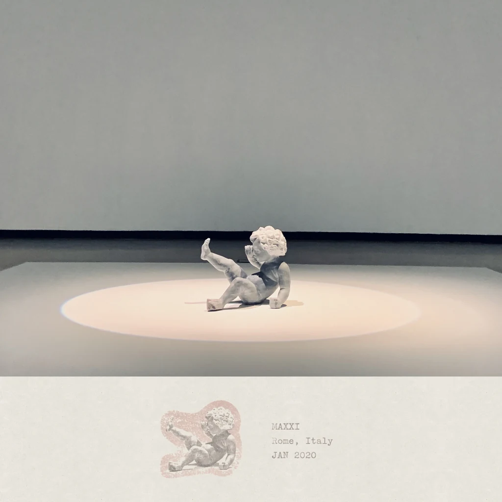
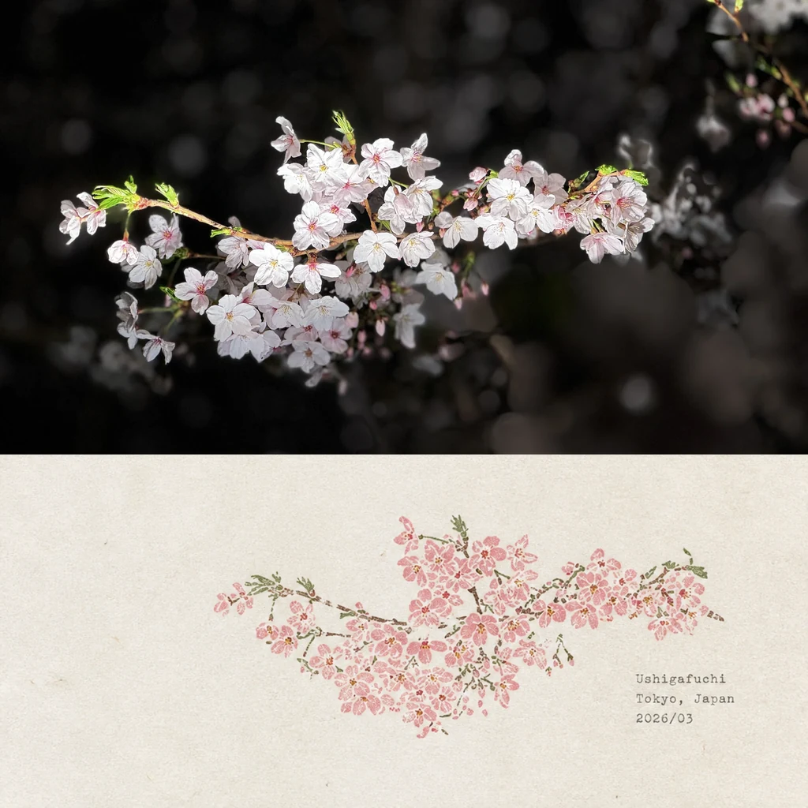
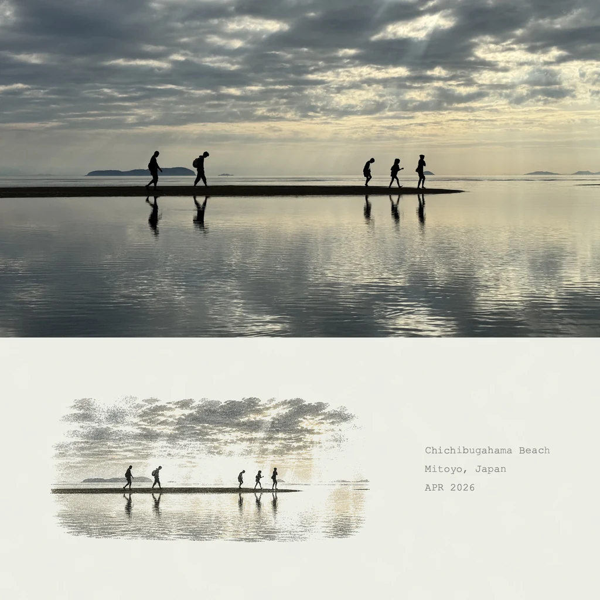
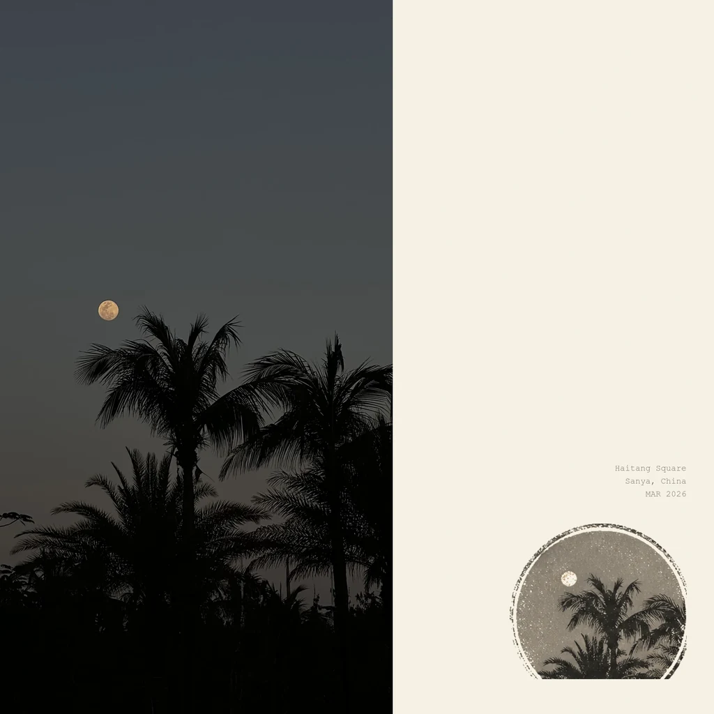
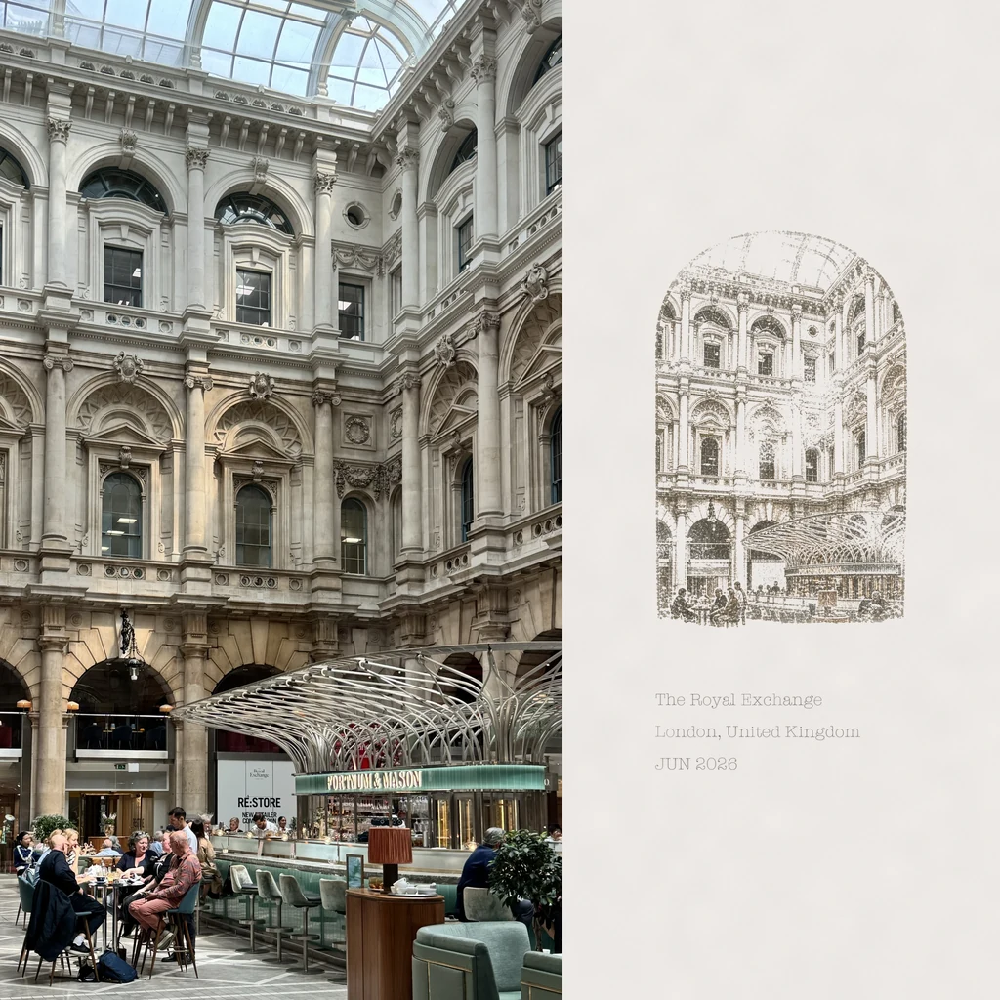
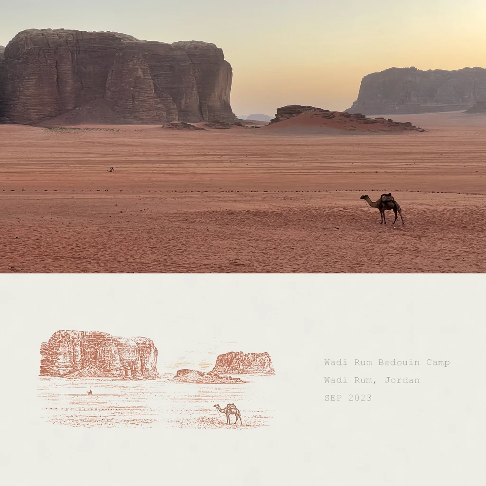
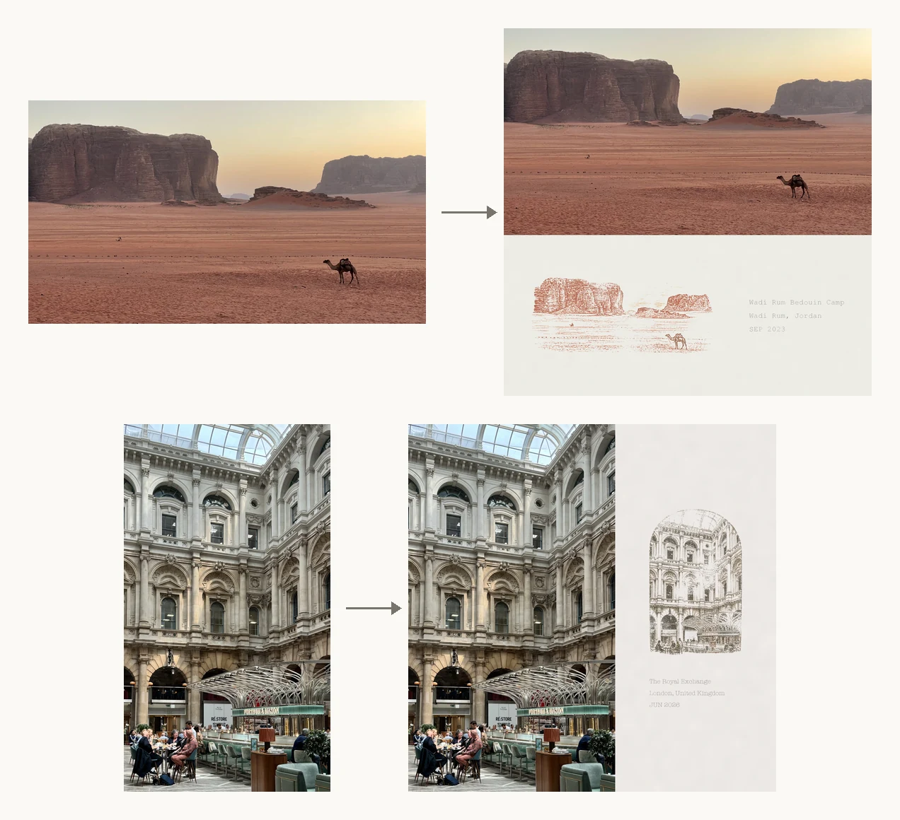
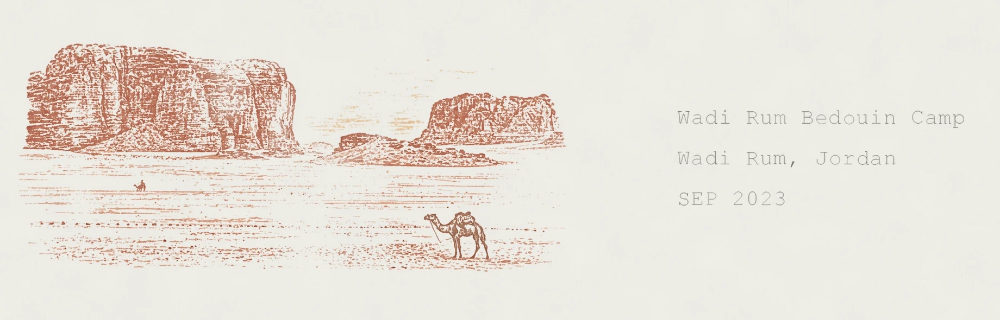

# Colophon 钤记

[English](README.md) · **简体中文**

*Colophon（版本记）：旧时书末的印刷者标记——一枚小小的徽记，加一行字，写明这本书在何时何地印成。*

一个适用于 Claude Code 和 Codex 的智能体技能（skill），把你的每一张照片做成一幅方形的纪念小品：照片保持原样，一侧接上一块暖白色的纸，纸上钤一枚按照片内容手工压印般的小印章，再配一行打字机字体的地点和日期。目标是让每一幅看起来像是手工盖印、手工打字的，而不是 AI 生成的。

<p align="center">
  
  
  
  
  
  
</p>

## 好在哪里

**不管怎么拍，出来都是同一个方形。** 竖拍、横拍、接近正方形、全景，结果一律是 2048×2048 的正方形。横向照片，纸接在下方；竖向照片，纸接在右侧。方向按 EXIF 旋转之后的真实尺寸判断，所以 iPhone 里侧着存储的照片不会被认错。

<p align="center">
  
</p>

**照片从不被重画。** 让图像模型一次画出整幅作品，大约一半会出错：画布不是正方形、照片被裁掉、纸接错了边。所以这里模型只画印章，版式交给脚本：照片按原始比例逐像素复制，不可能被裁切或变形。交付之前，技能会用 `verify.py` 检查每一张——是否正方形、纸是否在对的一侧、照片区域是否与原图一致。

**是手作的感觉，不是 AI 的感觉。** 印章虽然由图像模型绘制，但不应该有一处看起来像生成的。生成图像最容易露馅的是“匀”：细节匀、磨损匀、间距匀、左右对称。所以印章画成墨压在纸上的样子——细密的颗粒、残缺的边缘、不均匀的力道，有的地方清晰，有的地方缺墨——颜色取自照片本身实测的色板，而不是套用现成配色。题记是打字机打上去的，色带落在每个字母上的轻重都不一样；纸也有自己的纹理和色调。每张照片的压印轻重各不相同，就像一抽屉真实的盖印纸，清楚的和半干的并排放着。

<p align="center">
  
</p>

**恰到好处的随机，而且可以复现。** 如果一批作品的题记都在同一位置、同一字体，看起来就像套了模板。所以每张照片都会抽取自己的样子，范围都在统一风格之内：题记的字体和粗细、色带的磨损程度、印章和题记的位置、印章大小、纸的色调和纹理。随机种子取自文件名，所以相邻的照片各不相同，而同一张照片重跑结果完全一致——修改只会改你要求改的那一处。一个参数 `--variation` 就能调高、调低或关掉这种变化。

**题记不会写错字。** 地名和日期由脚本以真实文字、全分辨率排上去，从不交给图像模型去画，所以拼写准确、笔画清晰。

**修改几乎不花钱。** 印章小一点、纸新一点、题记淡一点、整组挪到角落：每一项都只是一个参数，几秒钟重新合成，不碰照片，也不用重新生成任何东西。只有改印章本身的画面，才需要重新生成一张图。

**按行号批量处理。** 指定地点日期表（CSV）的行号，文件名、题记和输出文件名都由脚本机械地算出来，不会处理错那十张照片。

## 快速开始

```bash
git clone https://github.com/xubing0602/colophon.git
mkdir -p ~/.claude/skills && ln -s "$PWD/colophon" ~/.claude/skills/colophon   # Claude Code
pip install -r colophon/scripts/requirements.txt
```

Codex 用户把整个文件夹复制到 `${CODEX_HOME:-$HOME/.codex}/skills/colophon`。**文件夹必须命名为 `colophon`**，要和 `SKILL.md` 里的 `name:` 一致。

把照片放进 `source/`，可选地准备一个 `manifest/metadata.csv`，每个文件一行地点和日期。然后对智能体说：

```
用 colophon 处理 source/ 里的照片。
```

```
用 colophon 处理 metadata.csv 第 112 到 121 行的图片。
```

智能体需要有生成图片的能力来画印章（Codex 自带；Claude Code 里可以用你接入的任何图像生成工具或 MCP 服务）。其余都是普通的 Python：Pillow、numpy，以及读取 iPhone `.heic` 文件用的 pillow-heif。

## 目录和表格约定

```
myproject/
  source/              原始照片，不要改动
  seals/               生成的印章，每张照片一枚
  output/              成品
  manifest/
    metadata.csv       题记，每张照片一行
```

```csv
file_name,place,city,state,country,lat,lng,year,month,month_name,day
IMG_4705.heic,Chaoyang Road,Beijing,Beijing,China,...,2026,3,MAR,19
```

默认只用到 `file_name`、`place`、`city`、`country`、`month_name`、`year`，题记排成三行：

```
Chaoyang Road
Beijing, China
MAR 2026
```

几条不用再每次交代的规则：

- 行号指**数据行，从 1 开始，不含表头**——第 112 行是文件的第 113 行。开始生成前，智能体会先列出首尾文件名让你核对。
- 输出文件名与源文件完全相同，只把扩展名换成 `.webp`：`source/IMG_3982.heic` → `output/IMG_3982.webp`。
- 2048×2048，不裁切，不变形，横图纸在下，竖图纸在右。

## 常用修改

| 你想要 | 怎么做 |
|---|---|
| `缩小 10%` | `--seal-scale 0.9` |
| `放大` | `--seal-scale 1.15` |
| `移动到右下` | `--anchor bottom-right` |
| `纸张不要那么旧` | `--paper-tone 242,240,235 --mottle 1.6` |
| `纸张质地更细` | `--grain 1.2` |
| 题记太重、太黑 | `--caption-opacity 0.72 --caption-weight 0` |
| 题记笔画太细 | `--caption-weight 0.3`（淡要靠墨色，不要靠细笔画） |
| 题记太淡、太花 | `--caption-wear 0.1` |
| 题记想要更旧的色带感 | `--caption-wear 0.7` |
| 题记放到印章下面 | `--layout stacked` |
| 题记颜色跟印章一致 | `--caption-tint 0.75` |
| `印章太干净` | `--seal-wear 0.6`，或用 `build_prompt.py --press starved` 重新生成 |
| 印章周围有一圈浅色方框 | `--seal-knockout 24` |
| 这一张整体换个样子 | `--seed 41`（任意数字） |
| 这一批太像 / 太乱 | `--variation 0.85` / `--variation 0.35` |
| 全部回到统一默认样式 | `--variation 0` |

只有改印章的**画面**——形状、边框、墨色、磨损质感、主体取舍——才需要重新生成印章；生成后只需重新合成，已经满意的成品不要整张重做。完整的对照表（含更多中文说法）见 [`reference/revisions.md`](reference/revisions.md)。

## 什么时候换另一条路

默认做法保留原照片。如果你想让照片被**重新诠释**——画成木刻、孔版、丝网印、版画或线描——或者原图太糊、太小、损坏，或者需要抹掉人脸、车牌，那就让模型画整幅作品。这条路同样受支持，写在 [`reference/full-composite-path.md`](reference/full-composite-path.md)。即便如此，正方形画布和纸的方向仍由 `verify.py` 严格把关；风格化的作品要用 `--metric structural` 检查，因为线描会让明暗反转，按默认的色调比对会被误判为不合格。

只是对印章、题记、纸张或位置不满意，不要换路——那些在默认做法里都是一个参数。

## 完整手册

每一步的手动操作、每个参数的说明、版式规则和故障排查，都在[英文 README](README.md#install) 里。智能体读的是 [`SKILL.md`](SKILL.md)。

## 许可

[MIT](LICENSE)
